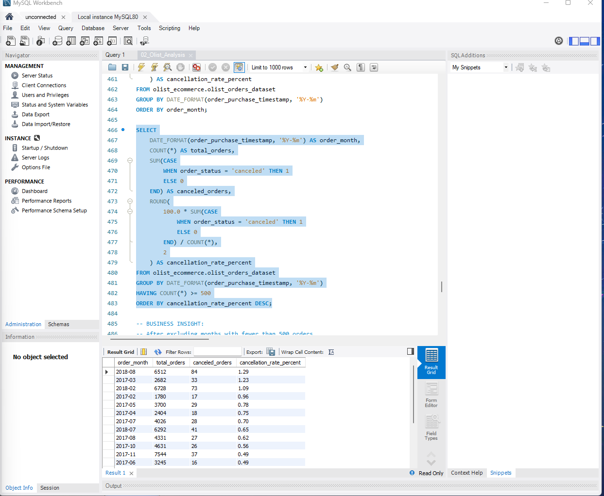

# Olist E-Commerce SQL Analysis

## Project Overview

This project uses MySQL to analyze the Brazilian Olist E-Commerce dataset, focusing on sales performance, order trends, average order value, and customer order cancellations.

The goal is to answer real-world business questions using SQL and translate the findings into meaningful business insights and recommendations.

## Tools Used

- MySQL
- MySQL Workbench
- SQL (JOINs, GROUP BY, aggregate functions, CASE statements, and date functions)

## Business Objectives

1. Analyze monthly sales performance and identify sales trends.
2. Identify the highest- and lowest-performing sales months.
3. Calculate average order value.
4. Measure overall and monthly order cancellation rates.
5. Compare cancellation patterns across Brazilian customer states.
6. Recommend areas for further business investigation.

## Key Findings

- **Overall cancellation rate:** Of 99,441 orders, 625 were cancelled, representing a cancellation rate of 0.63%.

- **Monthly sales performance:** November 2017 recorded significantly higher item sales than January 2017, driven mainly by increased order volume rather than higher average order value.

- **Average order value:** Average item sales per delivered order decreased from 149.06 in January 2017 to 135.51 in November 2017.

- **Monthly cancellation patterns:** August 2018 recorded the highest cancellation rate (1.29%) among months with at least 500 orders.

- **Geographical cancellation patterns:** Rondônia (RO) had the highest cancellation rate (1.19%) among customer states with at least 100 orders.

- **Cancellation volume:** São Paulo (SP) recorded the largest number of cancelled orders (327), highlighting the difference between cancellation counts and cancellation rates.


## Project Structure

```text
Olist_Ecommerce_SQL_Project/
│
├── 01_Olist_Setup.sql
├── 02_Olist_Analysis.sql
└── README.md
```

### File Descriptions

- **01_Olist_Setup.sql:** Contains the SQL setup instructions for the Olist e-commerce dataset.
- **02_Olist_Analysis.sql:** Contains SQL queries used to investigate sales performance, average order value, cancellation trends, and geographical patterns.
- **README.md:** Documents the project objectives, key findings, and business recommendations.

## Business Recommendations

1. **Investigate regional cancellation patterns:** Examine why Rondônia (RO) recorded the highest cancellation rate among states with at least 100 orders. Compare delivery performance, product categories, and seller locations before drawing conclusions.

2. **Prioritize high-volume markets:** Monitor São Paulo (SP), which recorded 327 canceled orders, because improvements in high-volume regions could have a meaningful operational impact.

3. **Review August 2018 cancellations:** Investigate the increase in cancellation rate to 1.29%, focusing on delivery delays, seller performance, and fulfillment issues.

4. **Monitor sales growth and customer spending:** Track monthly order volumes alongside average order value to understand whether sales growth is driven by more orders or greater spending per order.

5. **Build a monthly performance dashboard:** Track sales, delivered orders, average order value, cancellation counts, and cancellation rates to identify emerging trends.


## SQL Analysis Screenshot

### Monthly Order Cancellation Analysis



**Key insight:** August 2018 recorded the highest monthly cancellation rate (1.29%) among months with at least 500 orders, with 84 cancellations out of 6,512 orders.
